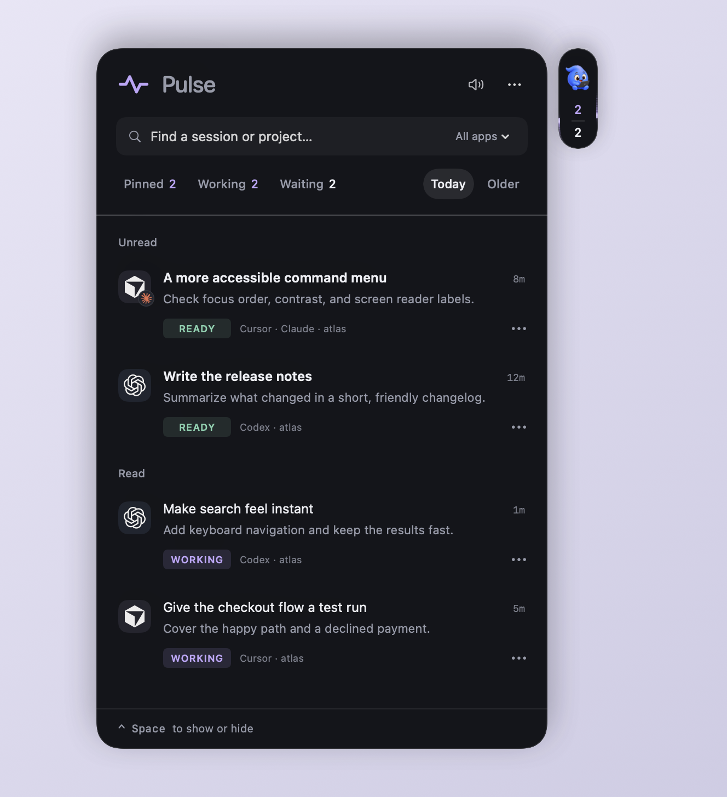
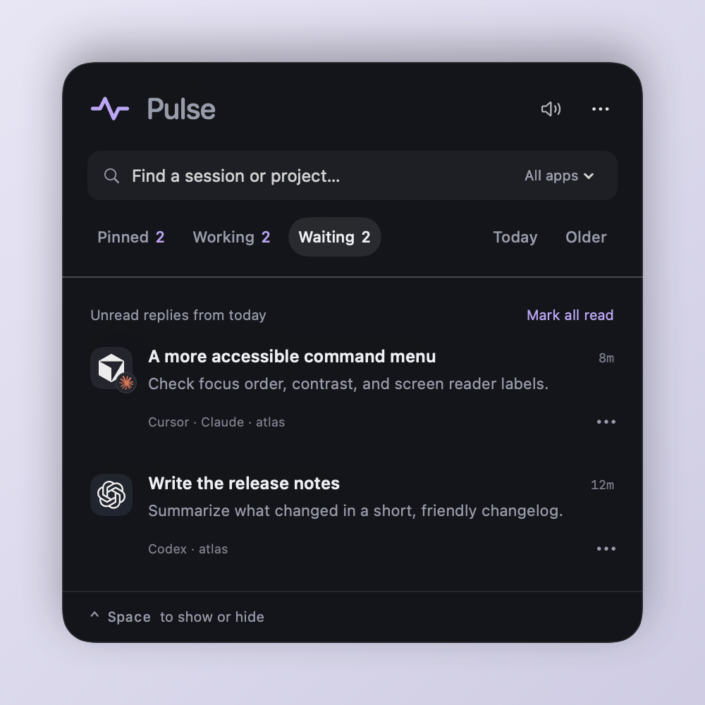
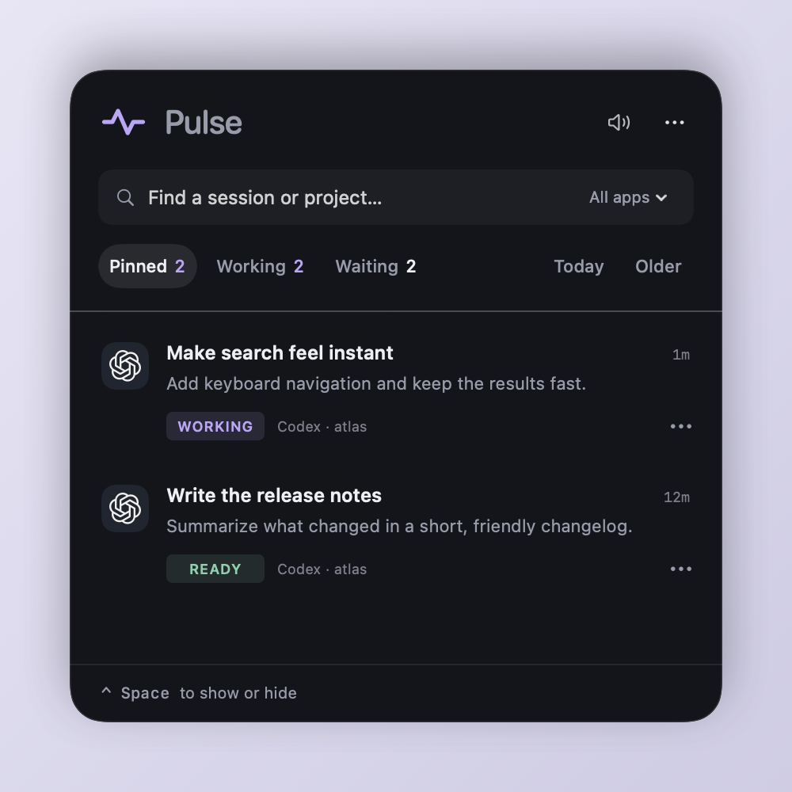

<p align="center">
  
</p>

<h1 align="center">Pulse</h1>

<p align="center">A Mac app for keeping track of your coding agents.</p>

<p align="center">
  <a href="https://github.com/felixs8696/pulse/releases/latest"><strong>Download for Mac</strong></a>
  &nbsp; · &nbsp;
  <a href="#get-started">Get started</a>
  &nbsp; · &nbsp;
  <a href="docs/GUIDE.md">User guide</a>
</p>

<p align="center"><sub>macOS 14+ &nbsp; / &nbsp; Apple Silicon + Intel &nbsp; / &nbsp; Runs locally</sub></p>

<p align="center">
  
</p>

<p align="center"><sub>Screenshots use sample conversations.</sub></p>

## How to use it

Hover over the pill to open your session list. Each row shows your last message. Click a row to return to that session in its original app.

- Click the pill to keep the panel open. Click again to collapse it, or press **⌃ Space** to show or hide it.
- Drag the pill or the panel's title area to move them together.
- Open a row's three-dot menu to pin it, mark a reply read or unread, or change its completion tone.
- Search by message, title, or project.
- Mark replies read when you've dealt with them. You can mark them unread again, and opening a session doesn't clear it.
- Mute sounds from the panel or menu bar.
- A pill appears on each connected monitor by default. Turn off **Show pill on every display** in the top-right menu if you prefer a single pill.

## Features

- Claude Code, Codex, and Cursor sessions in one list, with counts for agents working and waiting for you.
- One moving pulse around the pill's border per working agent. Three pulses means three active agents. As agents finish, their pulses fade away.
- A two-tap chime when a reply is ready. Each session keeps its own tone. Set its pitch from 1 (low) to 100 (high), or keep the automatic tone.
- Optional reply banners slide out beside the pill. Choose 5–60 seconds or keep them open until clicked. Different chats stack, and newer replies update their existing card. Banners appear on every display, with dismissal synced per chat. Hover to keep one open, or click to return to the session. Enable **Show reply banners** in the top-right menu.
- A floating pill that stays visible across Spaces, and appears on every connected display by default.

<table>
  <tr>
    <td width="50%" valign="top">
      
      <strong>Waiting</strong><br>
      Today's replies you haven't marked read, plus requests for input. Previous days' replies move to Older.
    </td>
    <td width="50%" valign="top">
      
      <strong>Pinned</strong><br>
      Pinned conversations stay here across days. You can still see whether they're working or waiting.
    </td>
  </tr>
</table>

## Get started

1. **[Download the latest ZIP](https://github.com/felixs8696/pulse/releases/latest)** and unzip it.
2. Drag **Pulse.app** into **Applications** and open it.
3. Hover the pill to see your sessions. Press **⌃ Space** to show or hide the panel.

Pulse is a menu-bar app, so it won't show up in the Dock. You can turn on launch at login from its menu.

> The app is ad-hoc signed and hasn't been notarized by Apple yet. If macOS blocks it, try opening the app, then go to **System Settings → Privacy & Security → Open Anyway**. Only do this for a copy you trust. More details are in the [installation guide](DISTRIBUTION.md).

### Supported apps

| Agent | Where you use it | Setup |
| :--- | :--- | :--- |
| Claude Code | iTerm, Cursor's Claude extension, Cursor terminal | Install the included Claude hooks. For Cursor, install the included session router too. |
| Codex | Codex Desktop | No extra setup for chats stored locally. |
| Cursor agents | Cursor | Install the included `pulse-router.vsix`. |

Follow the [setup guide](DISTRIBUTION.md#connect-your-apps) to install the Claude hooks and Cursor extension included in the ZIP.

Pulse tracks the conversations you interact with directly and excludes child agents and background tasks. Claude chat, Cowork, and ChatGPT chat aren't supported. Codex session links open in Codex Desktop. Returning to the original CLI pane isn't supported.

## Privacy and limitations

Pulse reads session files and databases on your Mac and saves pins, read state, and preferences locally. It doesn't upload conversations or collect analytics. You don't need an account or API key, and exported ZIPs don't include your session history or settings.

Updates to Claude Code, Codex, or Cursor can change their file formats or links and break tracking or navigation. Remote sessions only appear if the app has stored them locally. See the [user guide](docs/GUIDE.md#tracking-and-limits) for tracking details and known limits.

## Build it yourself

You'll need macOS 14+ and Apple's Command Line Tools (`xcode-select --install`). The build has no third-party dependencies to download.

```sh
git clone https://github.com/felixs8696/pulse.git
cd pulse
bash scripts/build.sh --run
```

| Task | Command |
| :--- | :--- |
| Run checks | `bash scripts/test.sh` |
| Export a universal Mac app ZIP | `bash scripts/export.sh` |
| Regenerate the sample screenshots | `bash scripts/screenshots/render.sh` |

Build output: `build/Pulse.app`. Shareable download: `build/Pulse-macOS.zip`.
